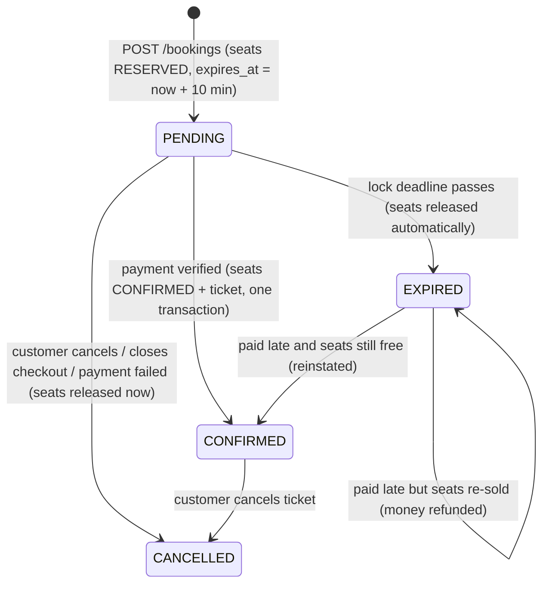
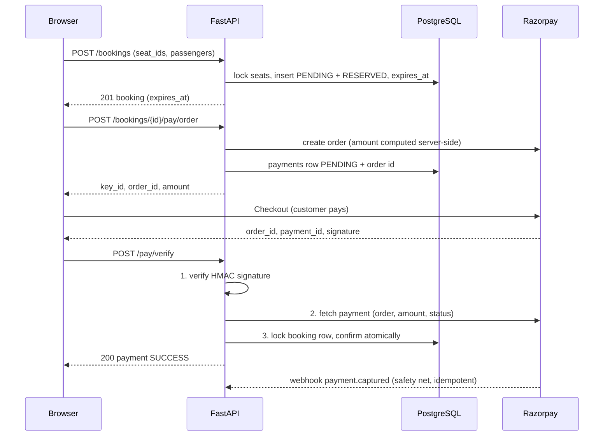

# Seat locking & Razorpay payments

How RailEase stops two people buying the same seat, and how a booking becomes
"confirmed" only after a payment has been verified on the server.

- Razorpay runs in **test mode** (demo — no real money moves).
- Everything below is implemented and covered by runnable checks (section 9).

---

## 1. What was built

| Requirement | Implementation |
|---|---|
| Razorpay in the existing payment flow | Order → Razorpay Checkout → server verification (`/bookings/{id}/pay/order`, `/pay/verify`) |
| Not confirmed until payment is verified | Only server code confirms a booking, after an HMAC check **and** a direct call to Razorpay |
| Success / failed / cancelled / interrupted | Each has a defined outcome (section 5.3), incl. webhook and a reconcile endpoint |
| Reuse existing architecture | Same `payments`, `bookings`, `booking_seats`, `tickets` tables; same router/service layering |
| Concurrent booking safety | Row locks + the existing partial unique index + clean 409 (section 4.3) |
| Temporary seat lock with a duration | `bookings.expires_at`, default **10 minutes** (`SEAT_LOCK_MINUTES`) |
| Auto-release on fail / cancel / expiry | `release_pending()`; lazy expiry on every read/write + a 30 s background sweeper |

---

## 2. The problem

Two customers open the seat map, both pick seat S1-5, both press "Continue" within
the same few milliseconds. Exactly one may end up holding it. Several things make
this harder than it sounds:

1. **Check-then-act race** – both requests *read* "seat is free" before either *writes*.
2. **Payment takes minutes** – the seat must be held during that time, but not forever.
3. **Abandoned payments** – closed tabs, dead batteries, declined cards. Held seats must come back.
4. **Money and inventory must agree** – never "paid but no seat", never "seat sold but unpaid".

---

## 3. How standard reservation systems handle it

The details differ, but they all combine the same few ideas. (Specific timeouts vary
by operator and change over time — the figures below are typical, not official.)

| System | How a seat is protected while the customer pays |
|---|---|
| **IRCTC (railways)** | Seats/berths come from a central reservation system. When you proceed to payment the system *blocks* the seats against your transaction; the payment page has a short session timer (a few minutes). If payment completes, a PNR is issued; if it fails, is abandoned or times out, the transaction is rolled back and the seats return to the pool. Allocation is serialised centrally, so two users can't be given the same berth. |
| **Airlines (GDS / PSS such as Amadeus, Sabre)** | Selling a segment creates a **PNR** and decrements inventory immediately (a "held" status). Each PNR carries a **ticketing time limit**; if it is not ticketed (paid) before then, an automated queue cancels it and the inventory is released. Seat-map seat assignments are similarly held for a short checkout window. |
| **Event / cinema ticketing (BookMyShow, Ticketmaster style)** | A **hold with a visible countdown** (typically 5–10 min). Implemented as a row with a `locked_until` timestamp or a Redis key with a TTL. Confirmed by the payment success callback; released by TTL expiry. |

### The shared building blocks

| Technique | What it gives you | Used here |
|---|---|---|
| **Pessimistic locking** (`SELECT … FOR UPDATE`) | Concurrent requests for the same rows queue up instead of racing | Yes – seat rows are locked in id order |
| **Database uniqueness constraint** | The final, un-bypassable guarantee: the DB refuses a second active reservation | Yes – `uq_active_seat_per_schedule` |
| **Soft lock with a TTL** | Temporary reservation during payment; auto-released | Yes – `PENDING` + `expires_at` |
| **Idempotent confirmation** | Retried / duplicated payment callbacks can't double-confirm | Yes – verify, webhook and reconcile share one routine |
| **Reconciliation** (webhook / polling) | Money and inventory converge even if the browser vanished | Yes – webhook + reconcile endpoint |
| **Sweeper job + lazy checks** | Expired holds are freed even if nobody is calling the API | Yes – both |

---

## 4. Our design

### 4.1 Booking state machine



A seat is "taken" for a schedule exactly when it has a `booking_seats` row whose
status is `RESERVED` or `CONFIRMED`. Releasing a seat just flips that row to
`CANCELLED`, which frees the unique-index slot.

### 4.2 How long is a seat locked? — 10 minutes

| Too short (< 5 min) | Too long (> 15 min) | Chosen: **10 min** |
|---|---|---|
| UPI app-switching + PIN, or card 3-D-Secure OTP, can take several minutes; customers pay *after* the lock ends | Abandoned checkouts starve real buyers of inventory | Long enough for slow UPI/OTP flows, short enough that abandoned seats return quickly |

It is configurable: set `SEAT_LOCK_MINUTES` (e.g. `1` for a live expiry demo). The
payment page shows a live countdown, and the deadline is stored server-side, so it
survives a page reload.

### 4.3 Three independent layers stop a double booking

1. **Row locks, then a fresh check** (`reserve_specific_seats`)
   - `SELECT … FROM seats WHERE id IN (…) ORDER BY id FOR UPDATE` — concurrent bookings that
     touch the same seat queue here. Ordered by id so two bookings can never deadlock.
   - Only *after* the lock is held do we check availability, in a **new statement**, so the
     previous holder's committed reservation is visible. (Checking inside the locking query
     would use a stale snapshot — see the bug below.)
2. **Database constraint** — the partial unique index
   `uq_active_seat_per_schedule ON booking_seats (schedule_id, seat_id) WHERE status IN ('RESERVED','CONFIRMED')`.
   Even if application code were wrong, the database physically cannot hold two active
   reservations for one seat on one schedule.
3. **Clean failure** — a lost race at layer 2 (`IntegrityError`) or a lock timeout
   (`lock_timeout = 5s`) is turned into **HTTP 409**, never a 500.

The whole booking (booking row + passengers + booking_seats) is a single transaction:
either everything is created or nothing is.

#### A real bug the load test uncovered

The original code locked seats with `FOR UPDATE SKIP LOCKED` and checked availability in
the *same* statement. Under heavy contention the check used a snapshot taken before the
winner committed, so the loser also "saw" a free seat, tried to insert, and was stopped
by the unique index — **no double booking (the DB constraint worked)**, but the unhandled
`IntegrityError` surfaced as **HTTP 500**.

| | 10 simultaneous users, 25 rounds, run 3× (750 attempts) |
|---|---|
| Before | winners 1/round ✔, but **500 errors in 2 of 3 runs** (1 and 3 per 250), losers got 400 |
| After | winners 1/round ✔ (75 total), **675 × 409, 0 × 5xx**, no `IntegrityError` in the server log |

### 4.4 Releasing seats

| Trigger | Mechanism |
|---|---|
| Customer cancels / closes checkout / payment declined | Immediate: `release_pending()` (seats → `CANCELLED`, open payments → `FAILED` with a reason) |
| Lock deadline passes | `expire_stale_holds()` (booking → `EXPIRED`, seats → `CANCELLED`) |

`expire_stale_holds()` runs **lazily** at the start of every endpoint that reads or
writes seat availability (search, seat map, create booking, my bookings, pay…) — so
correctness never depends on a background job — and also every 30 s from a background
task so stored state stays tidy when the API is idle.

It selects rows with `FOR UPDATE SKIP LOCKED` in id order: it never blocks, can't
deadlock, and never expires a booking whose payment is being confirmed *right now*
(that row is locked by the confirming transaction, so the sweep skips it).

### 4.5 Schema changes (one Alembic migration: `c5e2f8a1b3d7`)

| Table | Change |
|---|---|
| `bookings` | `expires_at timestamptz` (lock deadline); status enum gains `EXPIRED` |
| `payments` | `razorpay_order_id` (unique), `razorpay_payment_id` (unique), `failure_reason`; `payment_method` now nullable (unknown until the customer picks a method in Checkout) and the enum gains `OTHER` |

The unique `razorpay_payment_id` also makes a payment replay-proof: one gateway
payment can never be applied to two bookings. Existing `PENDING` bookings get a
back-filled deadline so stale ones are released on the first sweep. Everything is
additive, so the previously deployed code keeps working during the rollout.

---

## 5. Razorpay integration

### 5.1 Sequence



Only `key_id` ever reaches the browser. The secret stays on the server.

### 5.2 What the server checks before confirming

1. The caller owns the booking.
2. **HMAC-SHA256** of `order_id|payment_id` with the key secret matches the signature (constant-time compare).
3. **Razorpay is asked directly** (`GET /payments/{id}`): the payment belongs to *our* order, the amount equals the booking total in paise, and the status is `captured` (an `authorized` payment is captured first).
4. The booking row is locked (`FOR UPDATE`), then payment + booking + seats + ticket are updated in **one transaction**.

The amount is always computed server-side from the booking; nothing about price is trusted from the client.

### 5.3 What happens in every situation

| Situation | Result | Seats |
|---|---|---|
| Payment succeeds | `/pay/verify` → booking `CONFIRMED`, ticket issued | Confirmed |
| Forged / wrong signature | 400, nothing changes | Still locked until deadline |
| Amount or order mismatch | 400, nothing changes | Still locked |
| Card declined inside Checkout | Razorpay lets the customer retry in the same window; the reason is stored | Still locked |
| Customer **closes** Checkout (Razorpay asks "are you sure?") | `/pay/cancel` → booking `CANCELLED`, reason stored | **Released immediately** |
| Customer clicks "Cancel & release seats" | Same | **Released immediately** |
| Customer does nothing / leaves | Lock deadline passes | **Released automatically** (`EXPIRED`) |
| Paid, but **tab closed / network dropped** before `/pay/verify` | Webhook (if configured) confirms it; otherwise opening the payment page (or "Check payment" in My Trips) calls `/pay/reconcile`, which asks Razorpay and settles it | Confirmed |
| Paid **after the lock expired**, seats still free | Reinstated and confirmed | Re-taken atomically |
| Paid **after the lock expired**, seats already re-sold | **Automatic refund** via Razorpay; booking stays `EXPIRED`; customer is told | Not re-taken |
| Verify called twice / webhook + verify both arrive | Idempotent — one confirmation, one ticket | — |
| Razorpay unreachable during verify | 502; the payment page offers **Retry confirmation** ("don't pay again") | Still locked |
| Razorpay window fails to open (bad keys / blocked script) | UI returns to a retryable state after 8 s | Still locked |

### 5.4 Webhook (optional) and reconcile

- **Reconcile** (`POST /bookings/{id}/pay/reconcile`) needs no setup: it asks Razorpay
  whether the order was paid and runs the same idempotent settlement. The payment page
  calls it automatically on load.
- **Webhook** (`POST /payments/razorpay/webhook`) is the industry-standard backstop. To
  enable it, add a webhook in the Razorpay dashboard pointing at
  `https://<backend>/payments/razorpay/webhook` for `payment.captured` and
  `payment.failed`, and set `RAZORPAY_WEBHOOK_SECRET`. The signature of the raw body is
  verified before anything is trusted.

### 5.5 Mock fallback

If `RAZORPAY_KEY_ID` / `RAZORPAY_KEY_SECRET` are not set, the old mock gateway stays
available so local development and the live site keep working. When keys *are* set the
mock endpoint returns 403 — there is no way to confirm a booking without paying.

---

## 6. API reference (new / changed)

| Method | Path | Notes |
|---|---|---|
| GET | `/payments/config` | `{provider: "razorpay"\|"mock", key_id, seat_lock_minutes}` |
| POST | `/bookings` | Now returns `expires_at`; lost race → **409** |
| POST | `/bookings/{id}/pay/order` | Create (or reuse) the Razorpay order |
| POST | `/bookings/{id}/pay/verify` | Verify + confirm. 400 bad signature · 402 not captured · 409 paid too late (refunded) · 502 gateway error |
| POST | `/bookings/{id}/pay/cancel` | `{reason: "cancelled"\|"failed", detail?}` → releases seats |
| POST | `/bookings/{id}/pay/reconcile` | Settle a payment the browser never reported |
| POST | `/payments/razorpay/webhook` | Razorpay → server |
| POST | `/bookings/{id}/pay` | Mock gateway, only when Razorpay is not configured |

`BookingStatus` gains `EXPIRED`; `PaymentOut` gains `razorpay_order_id`,
`razorpay_payment_id`, `failure_reason` and a nullable `payment_method`.

---

## 7. Configuration & deployment

`backend/.env` (and Railway → fastapi-backend → Variables):

```
SEAT_LOCK_MINUTES=10
RAZORPAY_KEY_ID=rzp_test_xxxxxxxxxxxxxx
RAZORPAY_KEY_SECRET=xxxxxxxxxxxxxxxxxxxxxxxx
RAZORPAY_WEBHOOK_SECRET=            # optional
```

1. Razorpay Dashboard → switch to **Test mode** → Account & Settings → API Keys → generate keys.
2. Put them in `backend/.env` for local runs and in the Railway service variables for the live site.
3. Push to GitHub. Railway redeploys the backend and its start command runs `alembic upgrade head`
   (applies migration `c5e2f8a1b3d7`); Vercel redeploys the frontend.
4. The seed creates 5 trains (Delhi⇄Mumbai Rajdhani, Mumbai→Pune→Chennai Express, Chennai⇄Bengaluru Shatabdi)
   with a daily departure for the next 30 days. Re-run `python seed.py` (idempotent) whenever the window runs low:
   locally with `DATABASE_URL` set, or on Railway → fastapi-backend → **Console**.

Test payment details (shown on the payment page): domestic Mastercard **`5267 3181 8797 5449`**,
any future expiry, any CVV, then any 6-digit OTP on the simulated bank page.
Note: the generic Visa test card `4111 1111 1111 1111` is *declined* on this Razorpay account
("International cards are not supported") — handy for demonstrating a failed payment.
Which methods appear (cards / netbanking / wallet / UPI) depends on what is enabled on the Razorpay account;
this account currently offers cards, netbanking and wallets.

---

## 8. Demo script for the faculty

**A. Two people, one seat (the race)**
1. Open the site in two browsers (or one normal + one private window), logged in as different users.
2. Both open the same train/date/coach/bay and select the **same seat**.
3. Press *Continue* on both. One gets the payment page with a countdown; the other gets
   "Seat(s) no longer available — please re-select" (HTTP 409).
4. Meanwhile, the loser's seat map greys the seat out within ~8 seconds, and a seat that was
   in their selection is removed with a notice.
5. Show it at scale: `python backend/race_demo.py --users 10 --rounds 25` → *exactly one winner per round, no errors*.

**B. Pay with Razorpay**
1. Winner presses *Pay* → Razorpay Checkout → test card → success → ticket.
2. Point out: the booking only became `CONFIRMED` after the server verified the signature and asked Razorpay.

**C. Auto-release**
- *Cancel*: open Checkout and close it → "Payment cancelled — seats released"; the other user can now book the seat.
- *Expiry*: set `SEAT_LOCK_MINUTES=1`, book a seat and wait → the page flips to "Seat lock expired"; the seat is free again; the booking shows **EXPIRED** in My Trips.
- *Failure*: pay with the Visa test card `4111 1111 1111 1111` → Razorpay declines it; the booking stays pending (retry allowed) until the customer closes the window or the lock expires.

**D. Under the hood**
- Show the unique index (`\d booking_seats`) and explain: even a buggy app could not double-book.
- Run `python backend/payment_flow_check.py razorpay` — 45 scenario checks, all green.
- Show the Razorpay dashboard (test mode → Transactions): the payments and orders created by your demo appear there.

---

## 9. Evidence

| Check | Command | Result |
|---|---|---|
| Concurrent booking | `python race_demo.py --users 10 --rounds 25` ×3 | 75 winners (1 per round), 675 × 409, **0 × 5xx** (before: up to 3 × 500 per 250) |
| Full lifecycle, Razorpay path | `python payment_flow_check.py razorpay` | **45 / 45** |
| Full lifecycle, mock path | `python payment_flow_check.py mock` | **16 / 16** |
| Migration | `alembic upgrade head`, `downgrade -1`, `upgrade head`, `alembic check` | up/down/up clean; "No new upgrade operations detected" |
| Frontend | `tsc --noEmit`, `vite build` | clean |

`payment_flow_check.py` starts the real app against a real Postgres and replaces **only the
network call to Razorpay** with an in-memory fake, so the HMAC checks, row locks, unique
index, expiry and refund logic are all the production code. It covers: paid · forged
signature · amount mismatch · declined · cancelled · expired · paid-after-expiry (reinstated
and refunded) · webhook (valid/invalid/replay) · interrupted payment via reconcile ·
someone else's booking · sweep-vs-settlement locking.

### Verified against the real Razorpay test gateway

Besides the automated checks above (which fake only Razorpay's network call), the flow was also driven by
hand in a browser against **Razorpay's real test-mode Checkout** with real `rzp_test_*` keys:

| Scenario | What happened | Result |
|---|---|---|
| Declined payment | Visa `4111…` → Razorpay: "International cards are not supported" | Booking stayed `PENDING`, seat still held, timer still running; customer could retry |
| Successful payment | Domestic Mastercard `5267 3181 8797 5449` + OTP | Booking + seat `CONFIRMED`, ticket issued; DB row matched Razorpay's own record (`captured`, 70000 paise, method `card`) |
| **Interrupted payment** | Paid, but our `/pay/verify` call was deliberately dropped (simulated network failure) | Razorpay showed `captured` while our DB still said `PENDING` — then reloading the payment page called `/pay/reconcile`, which confirmed the booking and issued the ticket with no second payment |
| Cancelled payment | Opened Checkout and closed it ("Yes, exit") | Booking `CANCELLED`, seat `AVAILABLE` on the seat map immediately |

The post-payment re-run of the race test (10 users × 25 rounds, server running with the real keys) was again
25 winners / 225 × 409 / **0 server errors**.

Not exercised: the optional webhook (it needs a public URL registered in the Razorpay dashboard; the reconcile
endpoint covers the same case without it) and the late-payment **refund** against the real gateway (covered by the
automated check with a fake gateway).

---

## 10. Limitations / possible extensions

- **Demo-grade, test mode.** No real money; production would add KYC'd live keys, PCI-aware logging, alerting on `refund_failed`.
- **Seat lock is per seat row**, so two bookings touching the *same seat on different dates* briefly queue behind each other while a booking transaction runs (milliseconds). A finer key (e.g. a Postgres advisory lock on schedule + seat) would remove that.
- **Refund on cancelling a *confirmed* ticket** is not automated (only the late-payment refund is).
- **Countdown uses the browser clock** against a server timestamp; a badly wrong device clock skews the display (the server deadline is still authoritative).
- **Single-instance sweeper**: with several backend replicas every replica would run it; that is harmless (idempotent, `SKIP LOCKED`) but redundant.
- **Waiting list / partial segments** (selling the same berth for non-overlapping legs) are not modelled.
